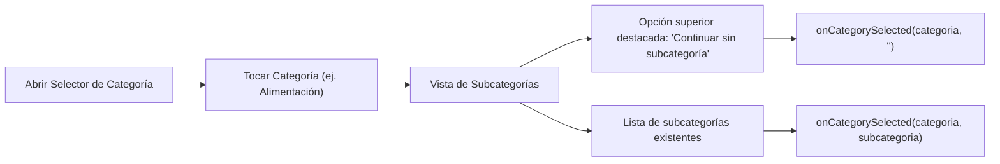

# Plan de Implementación: Subcategoría Opcional en Gastos, Ingresos y Presupuestos

## Descripción del Objetivo
Permitir a los usuarios registrar y editar **gastos**, **ingresos** y **presupuestos** seleccionando únicamente una categoría principal, haciendo que la selección de una subcategoría sea completamente opcional. 

Para que el flujo sea intuitivo, al tocar una categoría dentro de [CategorySelectionSheet.kt](file:///Users/nicolasanelkacasasparra/proyectos personales/money_saver/app/src/main/java/com/example/money_saver_android/ui/CategorySelectionSheet.kt) se abrirá la vista de esa categoría mostrando **arriba del todo** un botón/opción destacada **"Continuar sin subcategoría"**, permitiendo confirmar inmediatamente la categoría general sin obligar a elegir ni crear una subcategoría.



## Story & Criterios de Aceptación

### Story
Como usuario, quiero poder registrar y editar gastos, ingresos y presupuestos seleccionando únicamente una categoría sin que sea obligatorio escoger una subcategoría, mediante una opción clara e intuitiva en el selector de categorías, para agilizar mis registros financieros cuando no necesito un desglose por subcategoría.

### Acceptance Criteria
- [x] **Given** que el usuario abre el selector de categorías (`CategorySelectionSheet`) desde Gastos, Ingresos o Presupuestos y toca una categoría, **when** se muestra la vista de subcategorías de dicha categoría, **then** aparece en la parte superior una opción destacada `"Continuar sin subcategoría"` (`btn_select_category_without_subcategory`).
- [x] **Given** que el usuario se encuentra dentro de una categoría en `CategorySelectionSheet` (tenga o no subcategorías creadas), **when** pulsa `"Continuar sin subcategoría"`, **then** se selecciona la categoría con subcategoría vacía (`""`) y se cierra el selector mostrando únicamente el nombre de la categoría en el formulario.
- [x] **Given** un formulario de creación o edición de **Ingreso** con monto válido, período activo y categoría seleccionada pero sin subcategoría (`""`), **when** el usuario pulsa guardar, **then** el ingreso se guarda exitosamente sin exigir subcategoría.
- [x] **Given** un formulario de creación o edición de **Gasto** con monto válido y categoría seleccionada pero sin subcategoría (`""`), **when** el usuario pulsa guardar, **then** el gasto se guarda exitosamente y su tarjeta en el historial muestra el nombre de la categoría sin duplicar textos.
- [x] **Given** un formulario de creación o edición de **Presupuesto** con monto válido dentro del ingreso disponible y categoría seleccionada pero sin subcategoría (`""`), **when** el usuario pulsa guardar, **then** el presupuesto se guarda y se consolida correctamente en la asignación del período.

---

## User Review Required

> [!IMPORTANT]
> - **Cambio de regla de validación en Ingresos**: En [IncomeUseCase.kt](file:///Users/nicolasanelkacasasparra/proyectos personales/money_saver/app/src/main/java/com/example/money_saver_android/domain/usecase/IncomeUseCase.kt#L156-L158), la validación al guardar o actualizar un ingreso pasará de exigir categoría y subcategoría (`"Debes seleccionar una categoría y subcategoría"`) a exigir únicamente la categoría (`"Debes seleccionar una categoría"`), alineándose con `ExpenseUseCase` y `BudgetUseCase`.
> - **Diseño en `CategorySelectionSheet`**: En la vista de subcategorías se ubicará el botón **"Continuar sin subcategoría"** en la parte superior (encima del bloque `"Nueva subcategoría para ..."` y de la lista de subcategorías) para que sea la primera acción visible al entrar a cualquier categoría.

---

## Proposed Changes

### 1. Capa de Dominio y Datos

#### [MODIFY] [Expense.kt](file:///Users/nicolasanelkacasasparra/proyectos personales/money_saver/app/src/main/java/com/example/money_saver_android/domain/model/Expense.kt)
- Asignar valor por defecto `""` a `subcategory`:
```kotlin
data class Expense(
    val id: Long = 0,
    val amount: Double,
    val date: String,
    val description: String,
    val category: String,
    val subcategory: String = ""
)
```

#### [MODIFY] [Income.kt](file:///Users/nicolasanelkacasasparra/proyectos personales/money_saver/app/src/main/java/com/example/money_saver_android/domain/model/Income.kt)
- Asignar valor por defecto `""` a `subcategory`:
```kotlin
data class Income(
    val id: Long = 0,
    val amount: Double,
    val dateTime: String,
    val category: String,
    val subcategory: String = "",
    val description: String = "",
    val periodId: Long
)
```

#### [MODIFY] [ExpenseDatabase.kt](file:///Users/nicolasanelkacasasparra/proyectos personales/money_saver/app/src/main/java/com/example/money_saver_android/data/local/ExpenseDatabase.kt) y [RoomExpenseRepository.kt](file:///Users/nicolasanelkacasasparra/proyectos personales/money_saver/app/src/main/java/com/example/money_saver_android/data/repository/RoomExpenseRepository.kt)
- Cambiar `val subcategory: String? = null` en `ExpenseEntity` e incrementar `AppDatabase` a `version = 4`.
- En `RoomExpenseRepository`, mapear `subcategory.takeIf { it.isNotBlank() }` al persistir (`null` en SQLite cuando está vacío) y `entity.subcategory ?: ""` al leer hacia el dominio.

#### [MODIFY] [IncomesDatabase.kt](file:///Users/nicolasanelkacasasparra/proyectos personales/money_saver/app/src/main/java/com/example/money_saver_android/data/local/IncomesDatabase.kt) e [IncomeRepository.kt](file:///Users/nicolasanelkacasasparra/proyectos personales/money_saver/app/src/main/java/com/example/money_saver_android/data/repository/IncomeRepository.kt)
- Cambiar `val subcategory: String? = null` en `IncomeEntity` e incrementar `IncomesDatabase` a `version = 2`.
- En `RoomIncomeRepository`, mapear `subcategory.takeIf { it.isNotBlank() }` en `toEntity()` y `subcategory.orEmpty()` en `toDomain()`.

#### [MODIFY] [BudgetDatabase.kt](file:///Users/nicolasanelkacasasparra/proyectos personales/money_saver/app/src/main/java/com/example/money_saver_android/data/local/BudgetDatabase.kt) y [BudgetRepository.kt](file:///Users/nicolasanelkacasasparra/proyectos personales/money_saver/app/src/main/java/com/example/money_saver_android/data/repository/BudgetRepository.kt)
- Cambiar `val subcategory: String? = null` en `BudgetEntity` e incrementar `BudgetDatabase` a `version = 3`.
- En `BudgetRepository`, mapear `subcategory.takeIf { it.isNotBlank() }` en `toEntity()` y `subcategory.orEmpty()` en `toDomain()`.

#### [MODIFY] [ExpenseUseCase.kt](file:///Users/nicolasanelkacasasparra/proyectos personales/money_saver/app/src/main/java/com/example/money_saver_android/domain/usecase/ExpenseUseCase.kt)
- Agregar valor por defecto `subcategoryInput: String = ""` en `saveExpense` y `updateExpense`.

#### [MODIFY] [IncomeUseCase.kt](file:///Users/nicolasanelkacasasparra/proyectos personales/money_saver/app/src/main/java/com/example/money_saver_android/domain/usecase/IncomeUseCase.kt)
- En `saveIncome` y `updateIncome`, permitir `subcategoryInput: String = ""` y validar únicamente que `categoryInput` no esté vacío:
```diff
     suspend fun saveIncome(
         amountInput: String,
         dateTimeInput: String,
         categoryInput: String,
-        subcategoryInput: String,
+        subcategoryInput: String = "",
         descriptionInput: String,
         periodId: Long?
     ): IncomeResult {
         val amount = amountInput.replace(",", "").toDoubleOrNull() ?: 0.0
         if (amount <= 0.0) {
             return IncomeResult.Error("El monto debe ser mayor a cero")
         }
 
-        if (categoryInput.isBlank() || subcategoryInput.isBlank()) {
-            return IncomeResult.Error("Debes seleccionar una categoría y subcategoría")
+        if (categoryInput.isBlank()) {
+            return IncomeResult.Error("Debes seleccionar una categoría")
         }
```
*(Mismo ajuste en `updateIncome`).*

---

### 2. Interfaz de Usuario (Selector y Tarjetas)

#### [MODIFY] [CategorySelectionSheet.kt](file:///Users/nicolasanelkacasasparra/proyectos personales/money_saver/app/src/main/java/com/example/money_saver_android/ui/CategorySelectionSheet.kt)
- En la vista de detalle de una categoría (`selectedCategory != null`), añadir **arriba del todo** un botón/tarjeta destacada para continuar sin subcategoría:
```kotlin
// Botón destacado arriba del todo para usar solo la categoría sin subcategoría
Row(
    modifier = Modifier
        .fillMaxWidth()
        .clip(RoundedCornerShape(12.dp))
        .background(parentCategoryColor.copy(alpha = 0.15f))
        .border(1.dp, parentCategoryColor, RoundedCornerShape(12.dp))
        .clickable {
            onCategorySelected(selectedCategory.name, "")
        }
        .testTag("btn_select_category_without_subcategory")
        .padding(horizontal = 16.dp, vertical = 14.dp),
    horizontalArrangement = Arrangement.SpaceBetween,
    verticalAlignment = Alignment.CenterVertically
) {
    Row(verticalAlignment = Alignment.CenterVertically) {
        Text(text = selectedCategory.icon, fontSize = 18.sp)
        Spacer(modifier = Modifier.width(10.dp))
        Column {
            Text(
                text = "Continuar sin subcategoría",
                fontSize = 15.sp,
                fontWeight = FontWeight.SemiBold,
                color = TextPrimary
            )
            Text(
                text = "Usar solo ${selectedCategory.name}",
                fontSize = 12.sp,
                color = TextSecondary
            )
        }
    }
    Text(
        text = "✓",
        fontSize = 16.sp,
        fontWeight = FontWeight.Bold,
        color = GreenAccent
    )
}

Spacer(modifier = Modifier.height(12.dp))
```

#### [MODIFY] [ExpenseCardItem.kt](file:///Users/nicolasanelkacasasparra/proyectos personales/money_saver/app/src/main/java/com/example/money_saver_android/ui/components/expenses/ExpenseCardItem.kt)
- Evitar que el nombre de la categoría se muestre duplicado en el título y subtítulo cuando el gasto no tiene ni subcategoría ni descripción:
```diff
                 Column(modifier = Modifier.weight(1f)) {
                     Text(
                         text = expense.subcategory.ifBlank { expense.category.ifBlank { "Gasto" } },
                         fontSize = 16.sp,
                         fontWeight = FontWeight.Bold,
                         color = TextPrimary
                     )
-                    Text(
-                        text = if (expense.description.isNotBlank()) expense.description else expense.category,
-                        fontSize = 13.sp,
-                        color = TextSecondary
-                    )
+                    val subtitle = when {
+                        expense.description.isNotBlank() -> expense.description
+                        expense.subcategory.isNotBlank() -> expense.category
+                        else -> ""
+                    }
+                    if (subtitle.isNotBlank()) {
+                        Text(
+                            text = subtitle,
+                            fontSize = 13.sp,
+                            color = TextSecondary
+                        )
+                    }
                 }
```

#### [MODIFY] [DeleteIncomeConfirmationDialog.kt](file:///Users/nicolasanelkacasasparra/proyectos personales/money_saver/app/src/main/java/com/example/money_saver_android/ui/components/incomes/DeleteIncomeConfirmationDialog.kt)
- Mostrar la línea secundaria con `income.category` solo cuando `income.subcategory.isNotBlank()`, evitando duplicar el nombre de la categoría cuando no hay subcategoría.

---

### 3. Pruebas (TDD)

#### [MODIFY] [CategorySelectionSheetTest.kt](file:///Users/nicolasanelkacasasparra/proyectos personales/money_saver/app/src/test/java/com/example/money_saver_android/ui/CategorySelectionSheetTest.kt)
- Añadir `test_category_sheet_allows_selecting_category_without_subcategory`:
  - Verifica que al hacer clic en una categoría aparece el botón `"Continuar sin subcategoría"` (`btn_select_category_without_subcategory`) y al pulsarlo se invoca `onCategorySelected("Employment", "")`.

#### [MODIFY] [IncomeUseCaseTest.kt](file:///Users/nicolasanelkacasasparra/proyectos personales/money_saver/app/src/test/java/com/example/money_saver_android/domain/IncomeUseCaseTest.kt)
- Actualizar `saveIncome_withoutCategoryOrSubcategory_returnsError` a `saveIncome_withoutCategory_returnsError` (validando el mensaje `"Debes seleccionar una categoría"`).
- Añadir `saveIncome_withoutSubcategory_returnsSuccessAndInserts` y `updateIncome_withoutSubcategory_returnsSuccessAndUpdates`.

#### [MODIFY] [ExpenseUseCaseTest.kt](file:///Users/nicolasanelkacasasparra/proyectos personales/money_saver/app/src/test/java/com/example/money_saver_android/domain/ExpenseUseCaseTest.kt)
- Añadir `saveExpense_withoutSubcategory_returnsSuccessAndInserts` y `updateExpense_withoutSubcategory_returnsSuccessAndUpdates`.

#### [MODIFY] [IncomeViewModelTest.kt](file:///Users/nicolasanelkacasasparra/proyectos personales/money_saver/app/src/test/java/com/example/money_saver_android/viewmodel/IncomeViewModelTest.kt)
- Actualizar `test_income_validation_rejects_missing_category_or_subcategory` para comprobar que:
  1. Sin categoría falla con `"Debes seleccionar una categoría"`.
  2. Con categoría (`"Employment"`) y sin subcategoría (`""`) guarda exitosamente el ingreso.

#### [MODIFY] [ExpenseViewModelTest.kt](file:///Users/nicolasanelkacasasparra/proyectos personales/money_saver/app/src/test/java/com/example/money_saver_android/ExpenseViewModelTest.kt)
- Añadir `saveExpense_withoutSubcategory_persistsAndUpdatesList`.

---

## Verification Plan

### Automated Tests
Se ejecutarán las suites de pruebas unitarias y de UI (Robolectric/Compose) con Gradle:
```bash
./gradlew testDebugUnitTest --tests "com.example.money_saver_android.domain.IncomeUseCaseTest" \
  --tests "com.example.money_saver_android.domain.ExpenseUseCaseTest" \
  --tests "com.example.money_saver_android.domain.BudgetUseCaseTest" \
  --tests "com.example.money_saver_android.viewmodel.IncomeViewModelTest" \
  --tests "com.example.money_saver_android.ExpenseViewModelTest" \
  --tests "com.example.money_saver_android.ui.CategorySelectionSheetTest" \
  --tests "com.example.money_saver_android.ui.IncomesViewTest" \
  --tests "com.example.money_saver_android.ui.ExpensesViewTest"
```

### Manual Verification
1. Abrir la pestaña **Gastos**, tocar `"Seleccionar categoría"`, elegir una categoría y tocar **"Continuar sin subcategoría"** arriba del todo. Ingresar monto y guardar. Verificar que el gasto aparece con el nombre de la categoría sin repetir texto.
2. Abrir la pestaña **Ingresos**, pulsar `"Registrar Ingreso"`, tocar `"Seleccionar categoría"`, elegir una categoría y pulsar **"Continuar sin subcategoría"**. Ingresar monto y guardar. Verificar que el ingreso se registra sin error.
3. Cambiar a la sub-pestaña **Presupuesto**, pulsar `"Registrar Presupuesto"`, tocar `"Seleccionar categoría"`, elegir una categoría y pulsar **"Continuar sin subcategoría"**. Ingresar monto y guardar. Verificar que se refleja tanto en la tarjeta de asignación como en el desglose de presupuestos.
