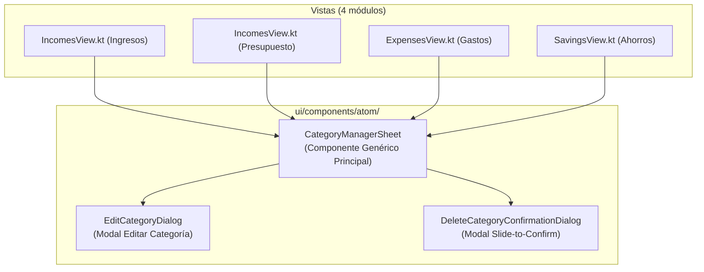

# Plan de Implementación: Componente Genérico de Selección y Gestión de Categorías en `atom`

## Objetivo

Construir un componente genérico reutilizable dentro de `app/src/main/java/com/example/money_saver_android/ui/components/atom/` para seleccionar y gestionar categorías y subcategorías de **Ingresos**, **Presupuesto**, **Gastos** y **Ahorros**, manteniendo consistencia total y replicando **exactamente** el diseño y la funcionalidad UI presentes en `app/src/main/java/com/example/money_saver_android/ui/ExpensesView.kt`.

### Decisiones Confirmadas
1. **Paridad total en los 4 módulos (Ingresos, Presupuesto, Gastos y Ahorros)**:
   - Menú contextual de tres puntos (`⋮` / `MoreVert`) en cada categoría con las opciones **Modificar** y **Eliminar**.
   - Diálogo modal de edición de categoría (nombre + paleta de colores + validación inline) respaldado por `updateCategory` transaccional en Room, Repositorios, UseCases y ViewModels.
   - Diálogo modal de confirmación de eliminación con `SlideToConfirmButton` en los 4 módulos (incluyendo **Ingresos**).
   - Integridad referencial cruzada al renombrar categorías de Presupuesto o Ahorros (actualizando `expenses.budgetCategory` / `expenses.savingCategory`).
2. **Compatibilidad con wrappers existentes**:
   - Mantener `CategorySelectionSheet.kt`, `EditExpenseCategoryDialog.kt`, `DeleteExpenseCategoryConfirmationDialog.kt`, `DeleteBudgetCategoryConfirmationDialog.kt` y `DeleteSavingCategoryConfirmationDialog.kt` como wrappers livianos que delegan a los nuevos componentes de `atom/` para evitar duplicación de UI sin romper los tests existentes.

---

## Arquitectura Propuesta



---

## Cambios Propuestos

### 1. Componentes Genéricos en `ui/components/atom/`

Siguiendo la convención de `ui/components/atom/PeriodSummaryCard.kt`, se crearán en `com.example.money_saver_android.ui.components.atom`:

#### [NEW] `app/src/main/java/com/example/money_saver_android/ui/components/atom/CategoryManagerSheet.kt`
- Modelo de estado compartido `CategoryEditState`:
  ```kotlin
  data class CategoryEditState(
      val originalName: String = "",
      val name: String = "",
      val color: String = "#4E73DF",
      val icon: String = "💰",
      val errorMessage: String? = null
  )
  ```
- Configuración de `testTag`s (`CategoryManagerTestTags`) con valores genéricos por defecto y sobreescribibles por módulo para mantener compatibilidad con los tests existentes de Gastos, Presupuesto y Ahorros.
- Composable principal **`CategoryManagerSheet`**:
  ```kotlin
  @Composable
  fun CategoryManagerSheet(
      visible: Boolean,
      categories: List<Category>,
      newCategoryName: String,
      selectedColorHex: String,
      categoryError: String?,
      newSubcategoryName: String,
      subcategoryError: String?,
      editingCategory: CategoryEditState?,
      categoryToDelete: Category?,
      onCategoryNameChange: (String) -> Unit,
      onColorSelect: (String) -> Unit,
      onCreateCategory: () -> Unit,
      onSubcategoryNameChange: (String) -> Unit,
      onCreateSubcategory: (categoryName: String) -> Unit,
      onEditCategoryClick: (category: Category) -> Unit,
      onEditCategoryNameChange: (String) -> Unit,
      onEditCategoryColorSelect: (String) -> Unit,
      onConfirmEditCategory: () -> Unit,
      onDismissEditCategory: () -> Unit,
      onDeleteCategoryClick: (categoryName: String) -> Unit,
      onConfirmDeleteCategory: () -> Unit,
      onDismissDeleteCategory: () -> Unit,
      onDeleteSubcategory: (categoryName: String, subcategoryName: String) -> Unit,
      onClearCategoryError: () -> Unit,
      onClearSubcategoryError: () -> Unit,
      onDismiss: () -> Unit,
      onCategorySelected: (category: String, subcategory: String) -> Unit,
      testTags: CategoryManagerTestTags = CategoryManagerTestTags(),
      deleteDialogTitle: String = t("expenses.delete_category_dialog.title"),
      deleteDialogWarning: String = t("expenses.delete_category_dialog.warning_message"),
      deleteDialogCancel: String = t("expenses.delete_category_dialog.cancel_button")
  )
  ```
- **Diseño y funcionalidad UI (exactamente igual a `ExpensesView.kt`)**:
  - Cuando `visible == true`, muestra `ModalBottomSheet` (`skipPartiallyExpanded = true`, `CardBackground`, `TextPrimary`):
    - Encabezado con botón volver (solo en vista de subcategorías), título (`"Seleccionar categoría"` o `selectedCategory.name`) y botón cerrar (`Icons.Default.Close`).
    - **Vista de Categorías**:
      - Tarjeta `"Nueva categoría"` (`FieldBackground`, `12.dp`): `OutlinedTextField` bordeado con `selectedCategoryColor`, botón `+`, `LazyRow` con `predefinedPalette` (círculos `28.dp`, borde blanco `3.dp` si está seleccionado) y texto de error `ErrorRed`.
      - Lista `LazyColumn` de categorías: círculo de color `12.dp`, ícono emoji `20.sp`, nombre `16.sp`, y menú de tres puntos `⋮` (`Icons.Default.MoreVert`, `btn_options_category_${category.name}`) con `DropdownMenu` -> **Modificar** (`btn_edit_category_${category.name}`) y **Eliminar** (`btn_delete_category_${category.name}`).
    - **Vista de Subcategorías**:
      - Tarjeta destacada **"Continuar sin subcategoría"** / `"Usar solo ${selectedCategory.name}"` (`btn_select_category_without_subcategory`) con borde y fondo tintado al color de la categoría padre.
      - Tarjeta `"Nueva subcategoría para ${selectedCategory.name}"` con `OutlinedTextField`, botón `+` y texto de error `subcategoryError`.
      - Lista `LazyColumn` de subcategorías: nombre clickeable, `IconButton` directo de eliminar (`btn_delete_subcategory_${sub.name}`) y `✓` verde.
    - Limpieza de errores (`categoryError`, `subcategoryError`) al cerrar/navegar y ocultamiento de teclado al confirmar formularios.
  - Cuando `editingCategory != null`, renderiza `EditCategoryDialog` (ocultando teclado al confirmar).
  - Cuando `categoryToDelete != null`, renderiza `DeleteCategoryConfirmationDialog`.
- Expone `CategorySelectionSheetContent` para que el wrapper legacy `ui/CategorySelectionSheet.kt` delegue sin duplicar UI.

#### [NEW] `app/src/main/java/com/example/money_saver_android/ui/components/atom/EditCategoryDialog.kt`
- Replica exactamente `EditExpenseCategoryDialog.kt`:
  - `Dialog` -> `Card` (`24.dp`, `CardBackground`, borde `1.dp BorderColor`) con `verticalScroll`.
  - Título, campo de nombre (`OutlinedTextField`), selector circular de color (`30.dp`, `predefinedPalette`), texto de error opcional (`ErrorRed`), botones **Cancelar** (`OutlinedButton`) y **Guardar** (`Button` con `GreenAccent`).
  - Soporta `testTags` configurables.

#### [NEW] `app/src/main/java/com/example/money_saver_android/ui/components/atom/DeleteCategoryConfirmationDialog.kt`
- Replica exactamente `DeleteExpenseCategoryConfirmationDialog.kt`:
  - `Dialog` -> `Card` (`24.dp`, `CardBackground`, borde `1.dp BorderColor`) con `verticalScroll`.
  - Insignia circular `48.dp` con `Icons.Default.Delete` en `ErrorRed`.
  - Título, tarjeta resumen (`FieldBackground`, `12.dp`) mostrando punto de color `12.dp` + emoji `20.sp` + nombre `17.sp Bold`.
  - Mensaje de advertencia, `SlideToConfirmButton` y botón **Cancelar** (`OutlinedButton`).
  - Soporta textos y `testTags` configurables.

---

### 2. Capa de Datos y Persistencia (Room + Repositorios)

#### [MODIFY] `app/src/main/java/com/example/money_saver_android/data/local/IncomesDatabase.kt`
- Agregar en `IncomeCategoryDao` (mismo patrón transaccional que `CategoryDao` en `ExpenseDatabase.kt`):
  - `updateCategoryStyle(name, color, icon)`
  - `reassignSubcategories(oldCategoryName, newCategoryName)`
  - `reassignIncomesCategory(oldCategoryName, newCategoryName)`
  - `@Transaction suspend fun updateCategory(oldName, newName, color, icon)`
- Hacer `countIncomesForCategory` y `countIncomesForSubcategory` insensibles a mayúsculas/espacios (`LOWER(TRIM(...))`).

#### [MODIFY] `app/src/main/java/com/example/money_saver_android/data/local/BudgetDatabase.kt`
- Agregar en `BudgetCategoryDao`:
  - `updateCategoryStyle(name, color, icon)`
  - `reassignSubcategories(oldCategoryName, newCategoryName)`
  - `reassignBudgetsCategory(oldCategoryName, newCategoryName)`
  - `@Transaction suspend fun updateCategory(oldName, newName, color, icon)`
- Hacer `countBudgetsForCategory` y `countBudgetsForSubcategory` insensibles a mayúsculas/espacios (`LOWER(TRIM(...))`).

#### [MODIFY] `app/src/main/java/com/example/money_saver_android/data/local/SavingsDatabase.kt`
- Agregar en `SavingCategoryDao`:
  - `updateCategoryStyle(name, color, icon)`
  - `reassignSubcategories(oldCategoryName, newCategoryName)`
  - `reassignSavingsCategory(oldCategoryName, newCategoryName)`
  - `@Transaction suspend fun updateCategory(oldName, newName, color, icon)`

#### [MODIFY] `app/src/main/java/com/example/money_saver_android/data/local/ExpenseDatabase.kt`
- Agregar en `ExpenseDao`:
  - `reassignBudgetCategory(oldCategoryName, newCategoryName)`
  - `reassignSavingCategory(oldCategoryName, newCategoryName)`

#### [MODIFY] Repositorios
- `IncomeRepository.kt`, `BudgetRepository.kt`, `SavingsRepository.kt`: agregar `suspend fun updateCategory(oldName: String, newName: String, color: String, icon: String) {}` (implementación por defecto vacía para no romper fakes de tests) e implementarlo en `RoomIncomeRepository`, `RoomBudgetRepository` y `RoomSavingsRepository`.
- `ExpenseRepository.kt` y `RoomExpenseRepository.kt`: agregar `suspend fun reassignBudgetCategory(oldName: String, newName: String) {}` y `suspend fun reassignSavingCategory(oldName: String, newName: String) {}`.

---

### 3. Capa de Dominio (UseCases)

#### [MODIFY] `app/src/main/java/com/example/money_saver_android/domain/usecase/IncomeUseCase.kt`
- Agregar `updateCategory(oldName, newNameInput, colorInput, iconInput)` protegido con mutex, validando nombre no vacío, existencia y duplicados insensibles a mayúsculas.
- Agregar `updateBudgetCategory(oldName, newNameInput, colorInput, iconInput)` con las mismas validaciones + `expenseRepository?.reassignBudgetCategory(target.name, trimmedNewName)`.

#### [MODIFY] `app/src/main/java/com/example/money_saver_android/domain/usecase/SavingsUseCase.kt`
- Agregar `updateCategory(oldName, newNameInput, colorInput, iconInput)` protegido con `savingMutex`, con las mismas validaciones + `expenseRepository?.reassignSavingCategory(target.name, trimmedNewName)` cuando cambie el nombre.

---

### 4. ViewModels

#### [MODIFY] `app/src/main/java/com/example/money_saver_android/viewmodel/ExpenseViewModel.kt`
- Definir `typealias EditExpenseCategoryState = CategoryEditState` para compatibilidad total.

#### [MODIFY] `app/src/main/java/com/example/money_saver_android/viewmodel/IncomeViewModel.kt`
- Agregar a `IncomeUiState`:
  - `editingCategory: CategoryEditState? = null`
  - `categoryToDelete: Category? = null`
  - `editingBudgetCategory: CategoryEditState? = null`
- Agregar `MSG_CATEGORY_UPDATED = "Categoría actualizada exitosamente"`.
- **Ingresos**:
  - Edición: `startEditingCategory`, `onEditCategoryNameChange`, `onEditCategoryColorChange`, `cancelEditingCategory`, `confirmEditCategory` (reconciliando `categoryInput` y `editingIncome?.category`).
  - Confirmación de eliminación: `requestDeleteCategory(Category / String)`, `dismissDeleteCategoryConfirmation`, `confirmDeleteCategory`.
  - Corregir `deleteCategory`: guardar error en `categoryError` en lugar de `errorMessage` para que el error se muestre dentro del sheet sin cerrarlo.
- **Presupuesto**:
  - Edición: `startEditingBudgetCategory`, `onEditBudgetCategoryNameChange`, `onEditBudgetCategoryColorChange`, `cancelEditingBudgetCategory`, `confirmEditBudgetCategory` (reconciliando `budgetCategoryInput` y `editingBudget?.category`).

#### [MODIFY] `app/src/main/java/com/example/money_saver_android/viewmodel/SavingsViewModel.kt`
- Agregar `editingSavingCategory: CategoryEditState? = null` a `SavingsUiState`.
- Agregar `MSG_CATEGORY_UPDATED = "savings.messages.category_updated"`.
- Agregar flujo de edición: `startEditingSavingCategory`, `onEditSavingCategoryNameChange`, `onEditSavingCategoryColorChange`, `cancelEditingSavingCategory`, `confirmEditSavingCategory` (reconciliando `savingCategoryInput` y `editingSaving?.category`).
- Limpiar `editingSavingCategory = null` al cambiar de período.

---

### 5. Integración en las 4 Vistas y Wrappers Legacy

#### [MODIFY] `app/src/main/java/com/example/money_saver_android/ui/ExpensesView.kt`
- Reemplazar `ExpenseCategorySheet`, `EditExpenseCategoryDialog` y `DeleteExpenseCategoryConfirmationDialog` (en `ExpensesTabContent` y `ExpensesView`) por `CategoryManagerSheet` de `ui.components.atom`.

#### [MODIFY] `app/src/main/java/com/example/money_saver_android/ui/IncomesView.kt`
- Unificar estado del sheet de Ingresos (`showIncomeCategorySheet`, `isIncomeCategorySheetForEdit`) y ocultar `AddIncomeDialog` / `EditIncomeDialog` mientras está abierto.
- Usar `CategoryManagerSheet` para Ingresos con menú `⋮` (Modificar / Eliminar), `EditCategoryDialog` y `DeleteCategoryConfirmationDialog` (con `SlideToConfirmButton`).
- Unificar estado del sheet de Presupuesto (`showBudgetCategorySheet`, `isBudgetCategorySheetForEdit`) y ocultar `AddEditBudgetDialog` mientras está abierto.
- Usar `CategoryManagerSheet` para Presupuesto reemplazando `CategorySelectionSheet` duplicados y `DeleteBudgetCategoryConfirmationDialog`.

#### [MODIFY] `app/src/main/java/com/example/money_saver_android/ui/SavingsView.kt`
- Reemplazar `CategorySelectionSheet` y `DeleteSavingCategoryConfirmationDialog` por `CategoryManagerSheet` conectado a edición + confirmación de borrado de categorías de Ahorros.

#### [MODIFY] Wrappers de compatibilidad
- `ui/CategorySelectionSheet.kt`: delegar a `CategorySelectionSheetContent` de `atom` (conservando `predefinedPalette`, `parseHexColor` y firma actual).
- `ui/components/expenses/EditExpenseCategoryDialog.kt`: delegar a `atom.EditCategoryDialog`.
- `ui/components/expenses/DeleteExpenseCategoryConfirmationDialog.kt`, `ui/components/budget/DeleteBudgetCategoryConfirmationDialog.kt`, `ui/components/savings/DeleteSavingCategoryConfirmationDialog.kt`: delegar a `atom.DeleteCategoryConfirmationDialog`.

---

### 6. Internacionalización (i18n)

#### [MODIFY] `app/src/main/assets/{es,en,de,pt}.json`
- Agregar `savings.messages.category_updated` en los 4 idiomas.
- Agregar `incomes.delete_category_dialog` (`title`, `warning_message`, `cancel_button`) en los 4 idiomas.

---

## Plan de Verificación

### Pruebas Automatizadas
1. Crear `CategoryManagerSheetTest.kt` para probar el componente genérico en `atom/`:
   - Creación de categoría con selección de color y manejo de errores.
   - Menú `⋮` con **Modificar** y **Eliminar**.
   - Flujo completo de `EditCategoryDialog` (guardar / cancelar / error).
   - Flujo completo de `DeleteCategoryConfirmationDialog` con `SlideToConfirmButton` (cancelar / confirmar).
   - Navegación a subcategorías, selección sin subcategoría, creación y borrado directo de subcategorías.
2. Agregar pruebas unitarias y Room para edición de categorías en Ingresos, Presupuesto y Ahorros (renombrado transaccional, migración de subcategorías/registros, validaciones, reconciliación de estado en ViewModel, y confirmación de borrado en Ingresos).
3. Agregar pruebas de integración UI en `IncomesViewTest.kt` verificando que las 4 pestañas (Ingresos, Presupuesto, Gastos y Ahorros) presentan el menú `⋮`, diálogo de edición y diálogo de eliminación deslizable.
4. Ejecutar toda la suite:
   ```bash
   ./gradlew testDebugUnitTest
   ```

### Verificación Manual
1. Probar en **Contabilidad** las 4 pestañas (**Ingresos**, **Presupuesto**, **Gastos**, **Ahorros**):
   - Abrir diálogo de crear y editar registro -> abrir selector de categorías.
   - Confirmar diseño y comportamiento 100% consistente con `ExpensesView.kt`: creación con color, menú `⋮` con Modificar y Eliminar, diálogo de edición, diálogo de borrado con botón deslizable, y gestión/selección de subcategorías (incluyendo "Continuar sin subcategoría").
