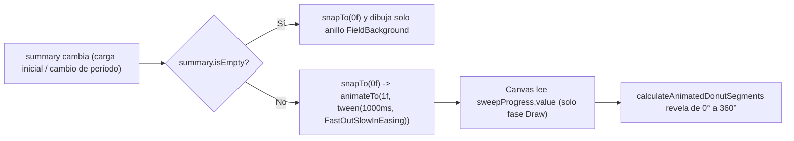

# Animación de llenado de 1 segundo en `PeriodSummaryDonutChart`

## Goal Description

Agregar una animación fluida de llenado completo (de `0°` a `360°`) al gráfico de dona en [`PeriodSummaryDonutChart.kt`](app/src/main/java/com/example/money_saver_android/ui/components/atom/PeriodSummaryDonutChart.kt) con una duración de **1 segundo (`1000 ms`)**, definiendo dicho tiempo en una constante global (top-level) dentro del mismo archivo del componente.

Actualmente, el componente dibuja inmediatamente todos los arcos de categoría de forma estática. Con este cambio, la dona se llenará progresivamente en sentido horario iniciando desde las 12 en punto (`-90°`) sobre el anillo base (`FieldBackground`), manteniendo intactos los textos centrales, las etiquetas de prueba (`testTag`) y el rendimiento de renderizado (invalidando únicamente la fase de dibujo en `Canvas`).

## User Review Required

> [!IMPORTANT]
> **Decisiones de diseño incluidas en este plan (confirma si deseas ajustar alguna antes de implementar):**
> 1. **Estilo de llenado**: Barrido secuencial continuo en sentido horario de `0°` a `360°` (revela la categoría 1, luego la 2, etc., hasta cerrar el círculo completo) sobre el anillo de fondo `FieldBackground`.
> 2. **Curva de aceleración (`Easing`)**: `FastOutSlowInEasing` (transición suave estándar de Material) durante `DONUT_FILL_ANIMATION_DURATION_MS = 1000`.
> 3. **Disparador de la animación**: `LaunchedEffect(summary)` para que la dona se anime al cargar datos inicialmente (cuando pasa de vacío a con datos) y también al cambiar de período o actualizarse el resumen. Gracias a la igualdad estructural de `PeriodCategorySummary`, **no** se reinicia en recomposiciones no relacionadas (como escribir en un formulario).
> 4. **Estado vacío (`summary.isEmpty`)**: Mantiene el anillo base estático `FieldBackground` sin animación de segmentos de color.

## Proposed Changes

### UI Atom Component

#### [MODIFY] [`PeriodSummaryDonutChart.kt`](app/src/main/java/com/example/money_saver_android/ui/components/atom/PeriodSummaryDonutChart.kt)

1. Definir la constante global a nivel de archivo para el tiempo de la animación:
   ```kotlin
   internal const val DONUT_FILL_ANIMATION_DURATION_MS: Int = 1000
   ```
2. Extraer el cálculo puro de los arcos animados en un helper `internal` (`DonutArcSegment` y `calculateAnimatedDonutSegments(summary, progress)`) para:
   - Recortar progresivamente los segmentos de categoría según `maxVisibleSweep = 360f * progress`.
   - Proteger contra valores no finitos (`NaN`, `Infinity`) o fuera de rango.
   - Facilitar pruebas unitarias determinísticas de la geometría en cualquier instante de la animación.
3. En `PeriodSummaryDonutChart`:
   - Mantener el progreso con `val sweepProgress = remember { Animatable(0f) }`.
   - Precalcular el mapa de colores con `remember(summary)` para evitar invocar `parseHexColor` en cada frame de la animación.
   - Ejecutar `LaunchedEffect(summary)` que reinicia a `0f` y, si `!summary.isEmpty`, anima hasta `1f` con `tween(durationMillis = DONUT_FILL_ANIMATION_DURATION_MS, easing = FastOutSlowInEasing)`.
   - Dentro de `Canvas`, dibujar siempre el anillo base (`FieldBackground`, `360°`) y luego dibujar los segmentos resultantes de `calculateAnimatedDonutSegments(summary, sweepProgress.value)`. Al leer `sweepProgress.value` dentro del bloque `Canvas`, Compose invalida únicamente la fase *Draw* sin recomponer el composable en cada frame.

```kotlin
internal const val DONUT_FILL_ANIMATION_DURATION_MS: Int = 1000

internal data class DonutArcSegment(
    val colorHex: String,
    val startAngle: Float,
    val sweepAngle: Float
)

internal fun calculateAnimatedDonutSegments(
    summary: PeriodCategorySummary,
    progress: Float
): List<DonutArcSegment> {
    if (summary.isEmpty || !progress.isFinite()) return emptyList()
    val clampedProgress = progress.coerceIn(0f, 1f)
    if (clampedProgress <= 0f) return emptyList()

    val maxVisibleSweep = 360f * clampedProgress
    val segments = mutableListOf<DonutArcSegment>()
    var startAngle = -90f
    var accumulatedSweep = 0f

    summary.items.forEachIndexed { index, item ->
        val remainingCircle = (360f - accumulatedSweep).coerceAtLeast(0f)
        val fullSweep = if (index == summary.items.lastIndex) {
            remainingCircle
        } else {
            val safeProportion = if (item.proportion.isFinite()) item.proportion else 0f
            (safeProportion * 360f).coerceIn(0f, remainingCircle)
        }
        if (fullSweep > 0f) {
            val remainingVisibleSweep = (maxVisibleSweep - accumulatedSweep).coerceAtLeast(0f)
            val animatedSweep = minOf(fullSweep, remainingVisibleSweep)
            if (animatedSweep > 0f) {
                segments.add(
                    DonutArcSegment(
                        colorHex = item.colorHex,
                        startAngle = startAngle,
                        sweepAngle = animatedSweep
                    )
                )
            }
            startAngle += fullSweep
            accumulatedSweep += fullSweep
        }
    }

    return segments
}
```



---

### Tests

#### [NEW] [`PeriodSummaryDonutChartTest.kt`](app/src/test/java/com/example/money_saver_android/ui/PeriodSummaryDonutChartTest.kt)

Agregar pruebas unitarias y de UI (Robolectric + Compose Test) para verificar:
- `DONUT_FILL_ANIMATION_DURATION_MS == 1000`.
- `calculateAnimatedDonutSegments`:
  - `progress = 0f` devuelve lista vacía.
  - `progress = 0.5f` revela exactamente `180°` comenzando en `-90°`.
  - `progress = 0.875f` dibuja múltiples segmentos contiguos sumando `315°` sin solapamientos ni brechas.
  - `progress = 1f` completa exactamente `360°` con las proporciones exactas de cada categoría.
  - Manejo seguro de `summary.isEmpty`, `progress < 0f`, `progress > 1f`, `Float.NaN` y proporciones inválidas.
- Prueba de UI en Compose con control manual del reloj (`mainClock.autoAdvance = false`) avanzando el tiempo a través de `0 ms`, `500 ms` y `1000 ms`, incluyendo transiciones de estado vacío a poblado y cambio de `summary`.

## Verification Plan

### Automated Tests

Ejecutar las pruebas unitarias y de UI relacionadas con el resumen y la dona mediante Gradle:

```bash
./gradlew testDebugUnitTest --tests "com.example.money_saver_android.ui.PeriodSummaryDonutChartTest" --tests "com.example.money_saver_android.ui.PeriodSummaryCardTest" --tests "com.example.money_saver_android.adversarial.PeriodSummaryAdversarialTest"
```

### Manual Verification

1. Abrir la app en el emulador o dispositivo en cualquiera de las vistas con resumen (`Gastos`, `Ingresos`, `Presupuesto` o `Ahorros`).
2. Confirmar que al cargar un período con registros, la dona se llena suavemente en sentido horario durante **1 segundo** hasta completar el círculo.
3. Cambiar de período financiero en el selector y verificar que la dona vuelve a animarse al mostrarse los nuevos datos.
4. Seleccionar un período sin registros y verificar que se muestra el anillo gris vacío sin glitches.
5. Interactuar con otros campos de la vista (ej. abrir/escribir en un formulario) y verificar que la dona **no** reinicia la animación si el resumen no cambió.
